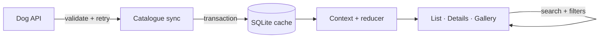
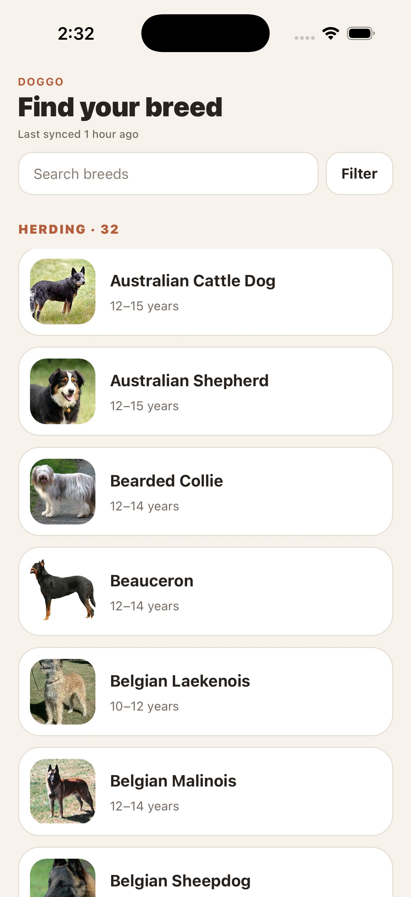
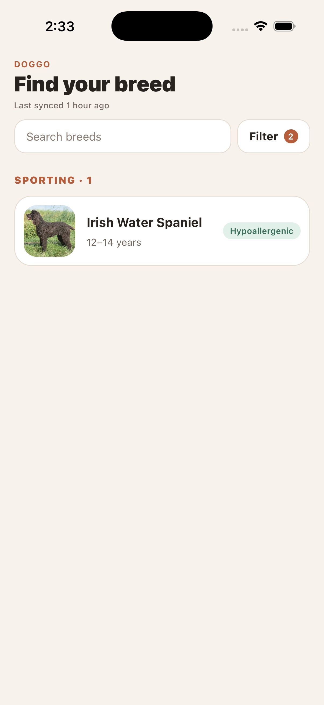
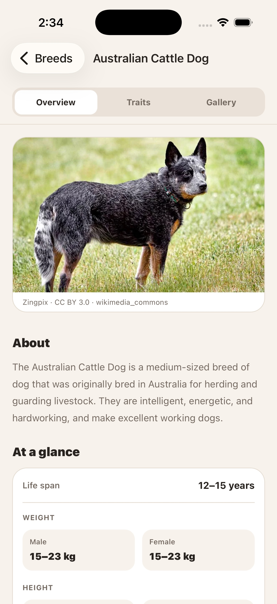
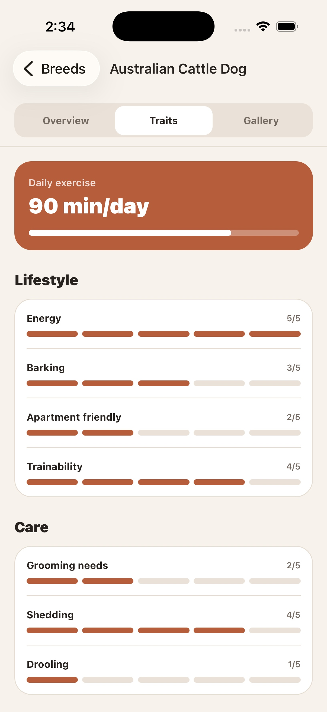
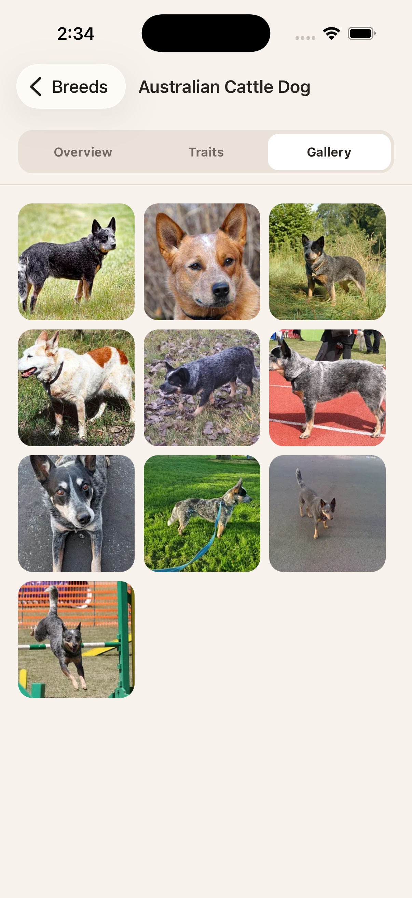
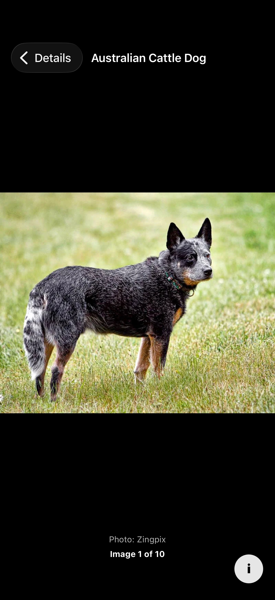

# Doggo

A mobile-first dog breed catalogue built as a bare React Native app with Expo
SDK modules, React Navigation, NativeWind, and SQLite.

## Quick Start

Prerequisites: Node.js with npm and an iOS or Android native development
environment.

```bash
npm install
npm run ios      # or: npm run android
```

After the development app is installed, start Metro with:

```bash
npm start
```

Run the project checks with `npm test`, `npm run lint`, and
`npm run typecheck`.

## 1. Architecture Overview

Doggo is offline-first. The app reads its SQLite catalogue at startup so saved
breeds appear immediately, then refreshes stale data from the Dog API. A React
context and reducer publish catalogue and synchronization state to the screens.

Screens handle navigation and temporary UI state. Breed feature modules contain
hooks, presentation, and pure transformations, while network and SQLite modules
own external data access. Global and route-level error boundaries contain
unexpected rendering failures.



**Data flow:** API responses are validated and merged, persisted to SQLite, and
then exposed to the UI through typed hooks. Breed details use the cache first and
fetch from the API only when missing.

See [Architecture](docs/ARCHITECTURE.md) for the complete system and data flow.

## 2. Key Technical Decisions

- **State management — React context and reducer:** one shared catalogue domain
  does not justify Redux. Explicit reducer phases model synchronization, while
  screen-only state stays local.
- **Database — SQLite:** structured local persistence makes cache contents,
  relationships, transactions, and offline behavior explicit. Only catalogue
  thumbnails are deliberately prefetched to disk; larger images load on demand.
- **Offline synchronization:** cached data renders first. Data older than 30
  minutes refreshes on launch, foregrounding, connectivity recovery, or manual
  refresh. The current six-page catalogue is fetched using API pagination
  metadata, merged by page, deduplicated by breed ID, and retained partially if
  a later page fails.
- **Navigation — React Navigation:** a typed static native stack is sufficient
  for the three explicit routes, so file-based Expo Router is unnecessary.
- **Failure handling:** expected request failures become UI states; unexpected
  render failures are contained by global and per-route error boundaries.

See [Technical decisions](docs/DECISIONS.md) for rationale and the SQLite schema.

## 4. Screenshots

| Breed list                                                      | Filters applied                                                             |
| --------------------------------------------------------------- | --------------------------------------------------------------------------- |
|  |  |

| Detail overview                                                        | Traits                                                      |
| ---------------------------------------------------------------------- | ----------------------------------------------------------- |
|  |  |

| Detail gallery                                                     | Full-screen gallery                                                          |
| ------------------------------------------------------------------ | ---------------------------------------------------------------------------- |
|  |  |

The catalogue header also hosts the offline and synchronization status banner.
A dedicated offline capture is not currently included in the screenshot set.
See the [screenshot index](docs/screenshots/app/README.md) for every captured
state.
