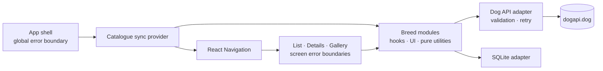
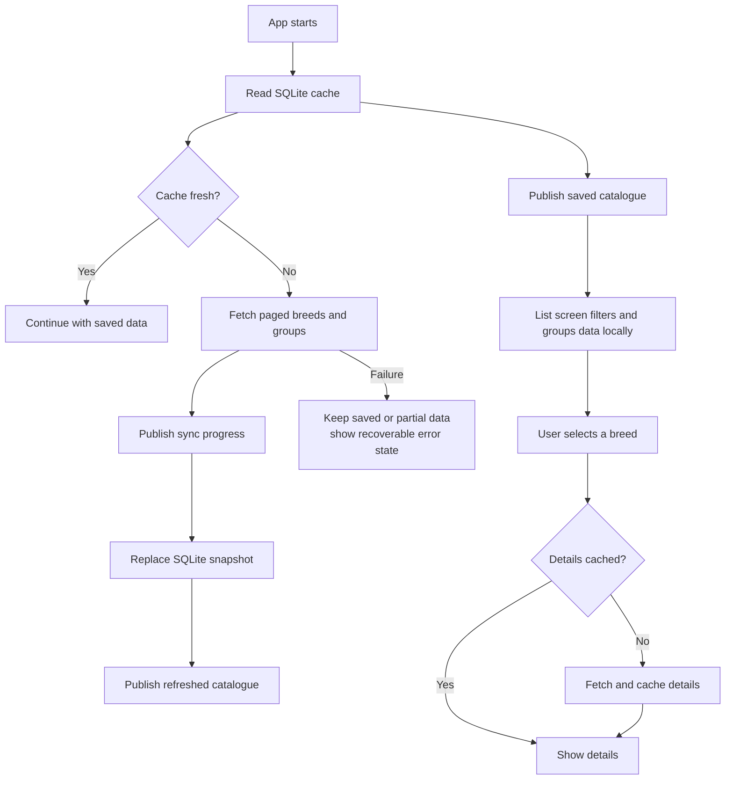

# Architecture

Doggo is an offline-first React Native app with committed iOS and Android native
projects—commonly called the bare workflow. It uses Expo SDK 56 modules and Expo
CLI/dev-client tooling, but Expo is a dependency rather than the project model.
The app shows saved breed data immediately, refreshes stale data from the Dog
API, and keeps screen-specific UI state local.

## System design

| Area | Responsibility |
| --- | --- |
| `src/screens` | Navigation-aware orchestration and screen states |
| `src/features/breeds` | Catalogue sync, hooks, filtering, grouping, and breed UI |
| `src/api` | Remote requests, response validation, and retry policy |
| `src/data` | SQLite schema and cached catalogue/detail persistence |
| `src/components` | Shared modal and error-boundary UI |

Screens depend on the breed modules; breed modules depend on the network and
database adapters. The adapters never depend on UI code.

## Data flow

Catalogue synchronization runs on launch when data is stale, when the app
returns to the foreground, after connectivity returns, and on manual refresh.
Concurrent triggers share one active synchronization.

## State and failures

- The catalogue provider owns shared server/cache state.
- Screens own temporary UI state such as search, filters, tabs, and sheets.
- Pure utilities perform filtering, grouping, scaling, and parsing.
- Expected network and cache failures become loading/error UI states.
- Unexpected render failures are contained globally and per screen by error
  boundaries; captured errors are logged but never rendered.

This separation keeps rendering independent from transport and persistence while
allowing the app to remain useful with stale or partial cached data.
