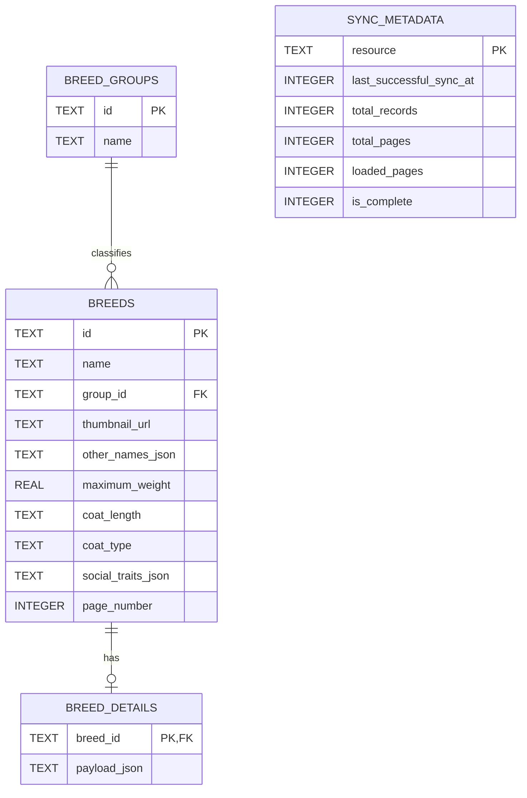

# Technical decisions

This log captures the choices agreed during Doggo's design. It records why each
choice exists and what it means for the implementation; the system walkthrough
stays in [ARCHITECTURE.md](ARCHITECTURE.md).

## 1. Use React Native with selected Expo dependencies

**Choice.** Keep the committed iOS and Android projects while using Expo SDK 56
modules, CLI tooling, and the development client.

**Why.** Native projects remain directly controllable, while maintained Expo
packages reduce the amount of platform-specific integration code. This is not
an Expo Router or managed-workflow application.

## 2. Manage shared state with Context and a reducer

**Choice.** `CatalogueSyncProvider` owns the shared catalogue and its explicit
sync phases. Screens own short-lived presentation state such as search text,
filter drafts, selected tabs, and open sheets.

**Why.** Doggo has one small shared domain. Context and a reducer make its state
transitions visible and testable without the dependency and conventions of
Redux. Search and filter results remain derived values rather than duplicated
state.

**Consequence.** Introduce a broader state library only if multiple independent
domains or complex cross-screen coordination make this boundary insufficient.

## 3. Validate and reduce data at the API boundary

**Choice.** Treat response JSON as `unknown`, validate it, and map only fields
needed by the catalogue, navigation, search, filters, and details UI into typed
models. API and database row shapes do not reach components.

**Why.** The remote payload is larger and less trustworthy than the app's
domain model. A narrow boundary limits memory use and prevents API changes from
spreading through the UI.

**Consequence.** A feature that needs another field must add it deliberately to
the validator, domain type, and—when persisted—the database mapping.

## 4. Persist an explicit offline snapshot in SQLite

**Choice.** Use `expo-sqlite` for the catalogue, breed details, groups, and sync
metadata. Replace a completed snapshot transactionally; enable foreign keys and
WAL mode.

**Why.** SQLite gives predictable ownership of offline data, atomic updates,
relationships, and inspectable sync metadata. A generic key-value cache would
hide those guarantees inside serialized blobs.

Stable catalogue values use columns; variable arrays and the nested detail
model use JSON. The schema is an internal cache format, not a second domain
model.

## 5. Synchronize progressively without discarding usable data

**Choice.** Read SQLite first. For a remote sync, fetch page 1 to discover
pagination, fetch page 2 when present, and wait for the concurrent group request
before publishing the initial batch. Fetch pages 3–N concurrently, then merge
them in page order and deduplicate by breed ID.

Search and filters stay disabled until background loading finishes. If a later
page ultimately fails, keep the available breeds, label the catalogue
incomplete, enable controls against that partial set, and offer a non-blocking
retry. Refresh retains the previous usable snapshot until its replacement is
ready. Groups never block breeds; missing groups fall back to “Other.”

**Why.** This shortens time to useful content without presenting a partial data
set as complete or blanking the app during refresh. Page count comes from API
metadata—the currently observed six pages are not hard-coded.

## 6. Retry only transient request failures

**Choice.** Make at most three attempts: immediately, then after 500 ms and
1,000 ms. Retry network failures, HTTP 408, 429, and 5xx responses. Do not retry
aborts, invalid responses, 404s, or other non-transient 4xx responses. Do not
add jitter.

**Why.** Bounded exponential backoff handles brief service interruptions while
keeping failure timing understandable and avoiding pointless retries for bad
requests or invalid data. The same policy applies to catalogue pages, groups,
and breed details.

## 7. Proactively cache only catalogue thumbnails

**Choice.** After sync, prefetch thumbnail URLs to the `expo-image` disk cache in
batches of 24. List rows also request the disk cache. Hero, gallery thumbnail,
and full-size image URLs load on demand and are not stored in SQLite.

**Why.** Catalogue thumbnails are small and repeatedly visible. Proactively
caching larger images would increase storage, network, decoding, and retained
memory costs. Native image and HTTP layers may still reuse larger files, but
that implicit cache is opportunistic rather than an application guarantee.

## 8. Use a typed React Navigation native stack

**Choice.** Use React Navigation 7 for the catalogue, details, and gallery.
Details receive `breedId`; the gallery receives `breedId` and `imageId`.

**Why.** Three explicit native routes do not benefit from file-based routing.
Typed route parameters keep navigation contracts checked without introducing
Expo Router.

## 9. Contain unexpected UI failures at two levels

**Choice.** Place one global error boundary outside the catalogue provider and
one boundary around each major route. Route fallbacks offer retry and Back when
available; their reset keys follow route identifiers. The global fallback is
terminal and asks the user to reopen the app.

**Why.** A failure in details or gallery should not take down the entire app,
while startup failures still need a safe final fallback. Expected network and
database failures remain normal application states rather than boundary errors.

**Privacy rule.** Boundaries log through `console.error`, but never render error
messages, stacks, component stacks, or application data in any environment.
